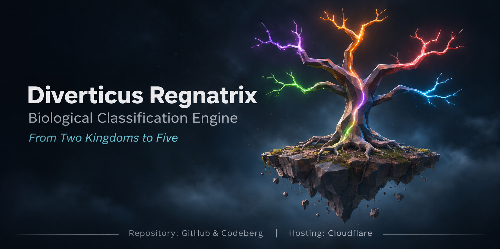
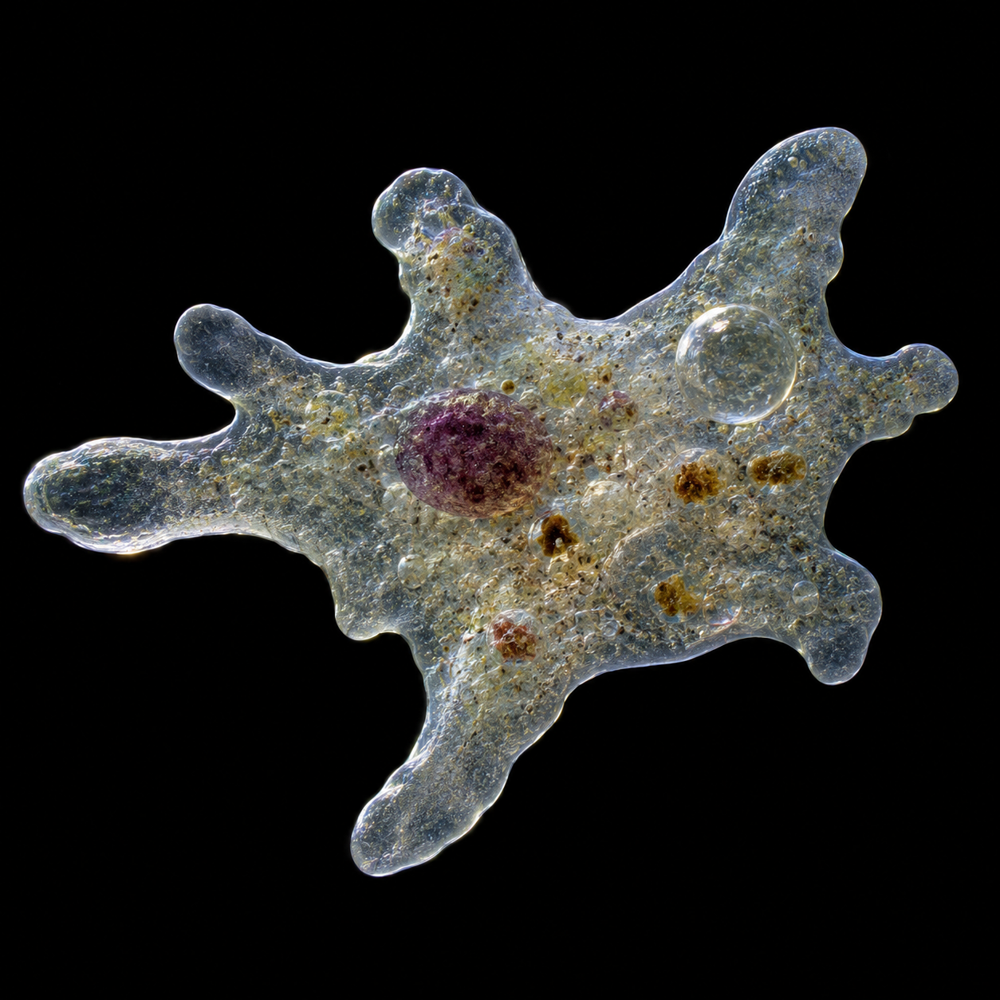

# Diverticus Regnatrix

*Biological Classification Engine · From Two Kingdoms to Five*

**[Explore Diverticus](https://YOUR-SITE.pages.dev)**

[About](#about) · [Screenshots](#screenshots) · [Gallery](#gallery) · [Views](#views) · [Controls](#controls) · [Technology](#technology) · [Credits](#credits) · [Releases](#releases) · [License](#license)

---

## About

Diverticus Regnatrix is an interactive classroom app on biological classification, built for Class 9 science. A single low-poly tree of life stays fixed while each classification system recolours its branches, so students see that organisms do not change, only the way scientists group them.

It covers Linnaeus' two kingdoms, Haeckel's three kingdoms, Copeland's four kingdoms, Whittaker's five kingdoms and Woese's three domains, with a dichotomous key, an organism classifier, side-by-side comparisons and illustrated example organisms, including the four major groups of Archaea.

## Screenshots

<table>
<tr>
<td width="50%"> <b>1 · Meet Regnatrix</b></td>
<td width="50%"> <b>2 · Tree of Life</b></td>
</tr>
<tr>
<td width="50%"> <b>3 · Easy Comparison</b></td>
<td width="50%"> <b>4 · Explore Organisms</b></td>
</tr>
<tr>
<td width="50%"> <b>5 ·
Mind Maps</b></td>
<td width="50%"> <b>6 · Chronological Slider</b></td>
</tr>
</table>

## Gallery

<table>
<tr>
<td width="33%" align="center"> <b>Plant Cell</b></td>
<td width="33%" align="center"> <b>Animal Cell</b></td>
<td width="33%" align="center"> <b>Bacterium</b></td>
</tr>
<tr>
<td width="33%" align="center"> <b>Amoeba</b></td>
<td width="33%" align="center"> <b>Mushroom</b></td>
<td width="33%" align="center"> <b>Methanobacterium</b></td>
</tr>
</table>

## Views

| View | What You See | Tap to Explore |
|---|---|---|
| Tree of Life | A tree on a floating island, branches coloured by the chosen system | Tap a branch for its group card; hold to see its organisms |
| Diagram | Box diagram with a feature label on every split | Tap a group to open its card |
| Phylogeny | Two systems side by side with a list of what moved | Pick any two systems and compare |
| Compare | Two organisms checked trait by trait | Choose organisms to see what is the same and what differs |
| Classify | Neon dichotomous key and organism classifier | Answer each character, or trace an organism to its kingdom |
| More | History, tricky cases, backup and references | Save a snapshot or back up your pictures |

**Concepts:** Prokaryote and eukaryote · Unicellular and multicellular · Cell wall · Autotrophic and heterotrophic nutrition · Dichotomous keys · History of classification · Three domains · Archaea

## Controls

| Control | Function |
|---|---|
| Tap | Open a group card, answer a key question or select an organism |
| Hold (0.5 s) | Show the organism pictures of a group |
| Double-tap | Open a picture full size |
| Hold (6 s) | Add or change an example picture |
| Swipe | Move between cards or pictures; swipe down to close |
| Header buttons | Theme, "Where does it go?", edit images, presentation mode |

## Technology

HTML · CSS · JavaScript · Inline SVG · WebP · Cloudflare Pages

<b>Project files</b>

| File | Contents |
|---|---|
| `index.html` | Page structure and the default picture links |
| `style.css` | Layout, themes and kingdom colours |
| `app.js` | Classification data, interactions and the tree-of-life image |
| `assets/` | Banner, screenshots and organism illustrations |

## Credits

| Contributor | Role |
|---|---|
| Sai Prasad, M.Sc. Agri. Entomology, ASRB NET | Project Designer |
| Claude Opus 5.5 | Development |
| OpenAI Astra 6 | Image Generation |
| Perplexity Sonar 2 | Scientific Reasoning |
| DeepSeek V1 | Assistance |

<b>3D models</b>

| Asset | Model | Creator | Licence |
|---|---|---|---|
| Tree | Tree (PS1/PSX Style) | Mateusz Woliński | Sketchfab Standard |
| Island | [Floating Island With Roots And Rocks](https://sketchfab.com/3d-models/floating-island-with-roots-and-rocks-4c05ffef4d1c45ab847ac565b8184a5b) | [Dennis](https://sketchfab.com/dennis.hafemann) | [CC BY 4.0](http://creativecommons.org/licenses/by/4.0/) |

Both models were combined and rendered to a single image; the hanging skeleton, bird and ground were removed from the tree model. This work is based on the island model, licensed under CC BY 4.0.

<b>Libraries and fonts</b>

| Component | Licence |
|---|---|
| No runtime libraries (vanilla JavaScript) | — |
| Inter, with system font fallback | SIL Open Font License 1.1 |
| three.js (used only to render the tree image) | MIT |

## Releases

| Release | Title | Date |
|---|---|---|
| [RC V](RELEASE_NOTES.md#rc-v--archaea) | Archaea | 17 Nov 2026 |
| [RC IV](RELEASE_NOTES.md#rc-iv--tree-of-life) | Tree of Life | 17 Nov 2026 |
| [RC III](RELEASE_NOTES.md#rc-iii--living-tree) | Living Tree | 16 Nov 2026 |
| [RC II](RELEASE_NOTES.md#rc-ii--neon-flowchart) | Neon Flowchart | 14 Nov 2026 |
| [RC I](RELEASE_NOTES.md#rc-i--foundation) | Foundation | 13 Nov 2026 |

## License

Released under the [GNU General Public License v3.0](LICENSE). Third-party 3D models remain under their own licences listed above.

---

<a href="https://github.com/Dray-Ashcroft/Diverticus-Regnatrix">GitHub</a> · Codeberg | Hosted on Cloudflare Pages

